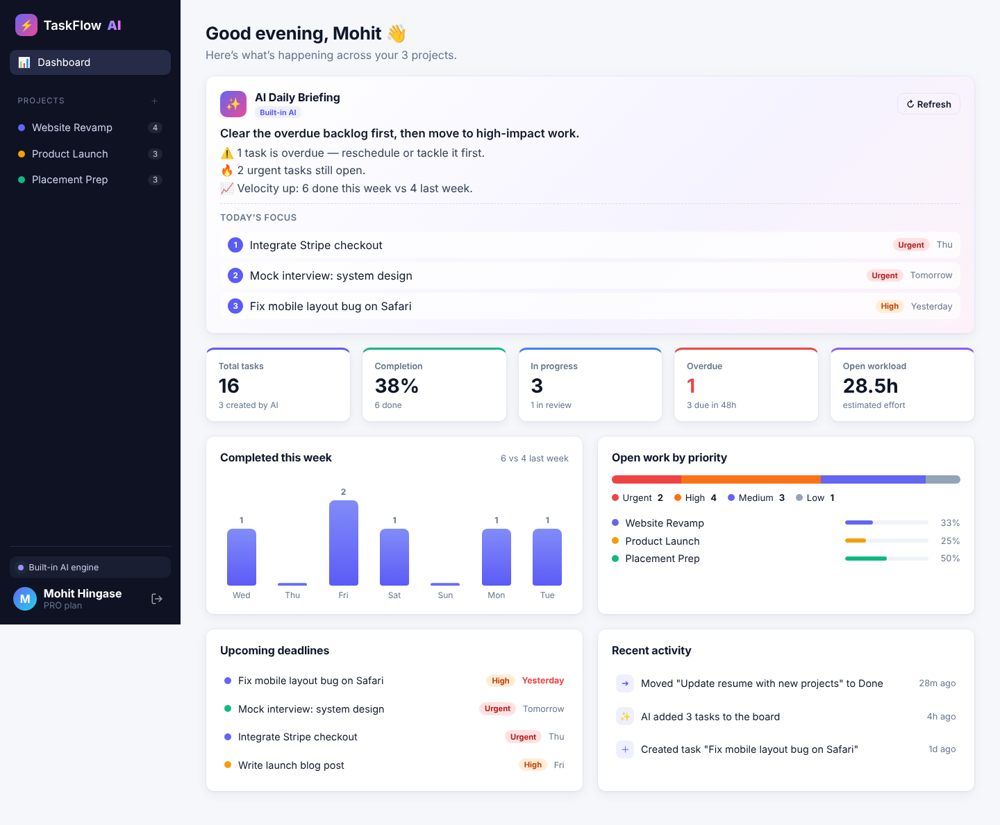
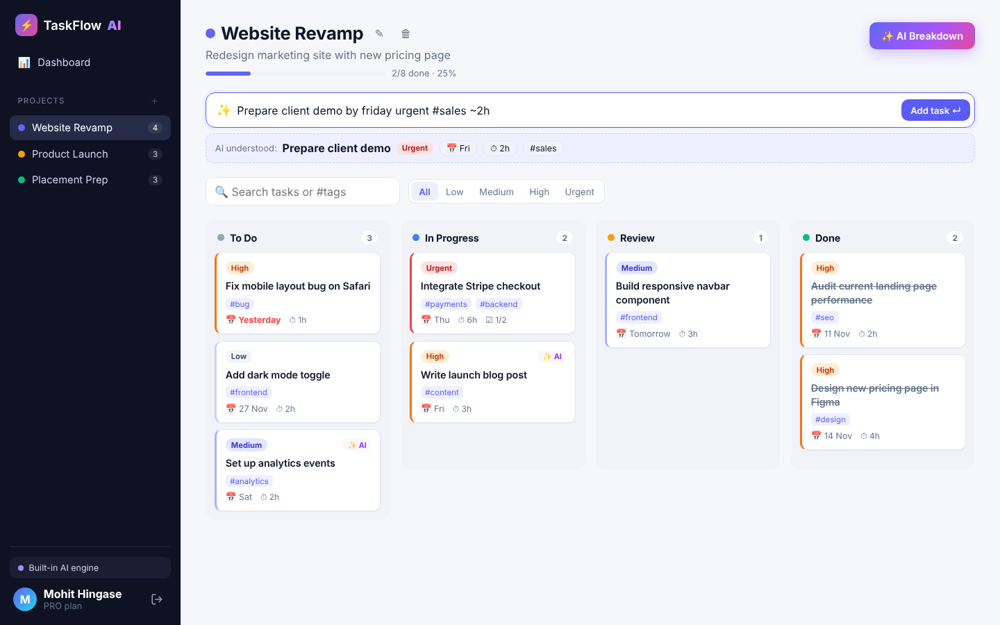
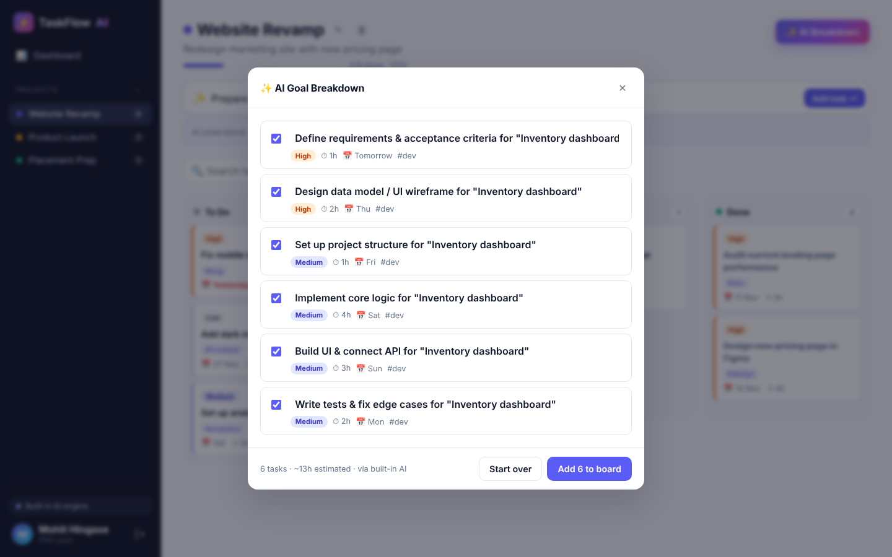
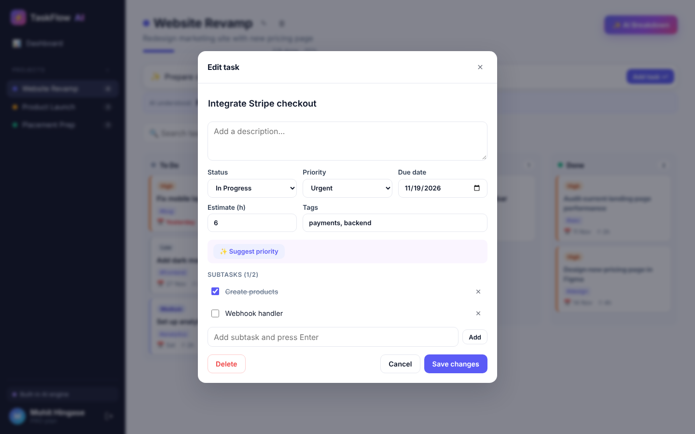
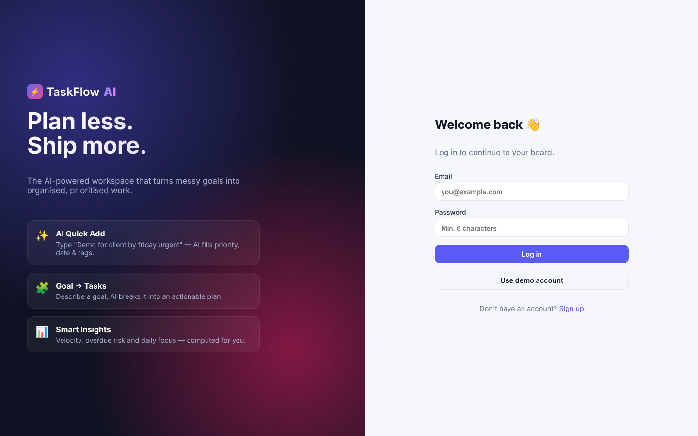
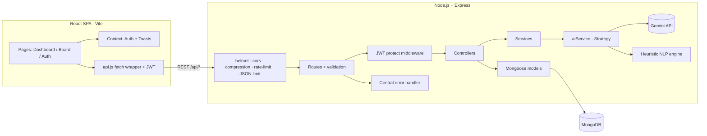
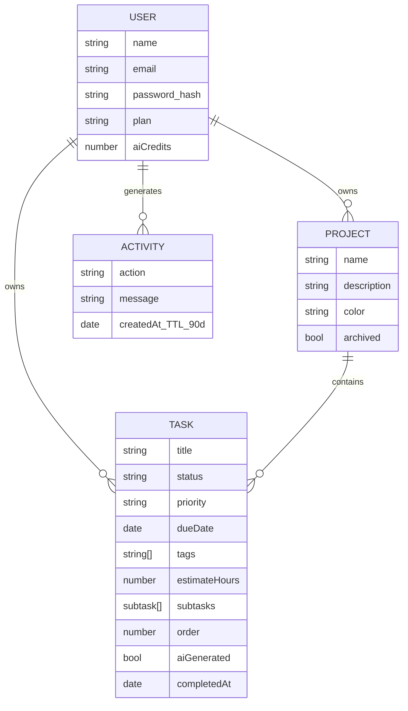

# ⚡ TaskFlow AI — AI-Powered Mini SaaS for Project & Task Management

> **Plan less. Ship more.** A full-stack productivity SaaS where AI turns messy goals into organised, prioritised work.

**Stack:** React 18 (Vite) · Node.js + Express · MongoDB (Mongoose) · Google Gemini (optional) · JWT Auth



---

## ✨ Features

### Core SaaS workflow
| Area | What it does |
|---|---|
| 🔐 **Auth & multi-tenancy** | Register / login with JWT + bcrypt. Every query is scoped to the logged-in user (tenant isolation). |
| 📁 **Projects** | Create, edit, colour-code and delete projects. Live progress % per project. |
| 🗂 **Kanban board** | 4-stage workflow (To Do → In Progress → Review → Done) with **drag & drop**, optimistic UI and bulk persistence. |
| 📝 **Rich tasks** | Priority, due date, tags, effort estimate, subtasks checklist, search & priority filters. |
| 📊 **Analytics dashboard** | Completion rate, overdue, workload hours, 7-day velocity chart, priority distribution, upcoming deadlines, activity feed. |
| 💳 **Plans & AI credits** | SaaS-style metering: each LLM call consumes a credit (`free` / `pro` / `team` plans). |

### 🤖 AI features
| Feature | How it works |
|---|---|
| **AI Quick Add (NLP)** | Type `Prepare client demo by friday urgent #sales ~2h` → AI extracts **title, priority, due date, tags, estimate**. |
| **Goal → Task Breakdown** | Describe a goal ("Build an inventory dashboard") → AI creates an ordered plan with estimates, priorities and staggered deadlines. Review/edit before adding. |
| **Smart Priority** | One click suggests a priority with a reason (deadline proximity + keywords). |
| **AI Daily Briefing** | Dashboard coach: headline, actionable insights and today's top-3 focus tasks. |

**Resilient AI design (Strategy pattern + graceful degradation):**
`Gemini LLM  →  (no key / error / 12s timeout)  →  built-in heuristic NLP engine`
The app is **fully functional without any API key**; add a free Gemini key to upgrade to LLM answers. Every AI response carries a `source` field so the UI is transparent about which engine answered.

| Board + AI Quick Add | AI Goal Breakdown |
|---|---|
|  |  |

| Task editor + Smart Priority | Login |
|---|---|
|  |  |

---

## 🏗 Architecture



**Layered backend** — `routes → middleware → controllers → services → models`. Controllers stay thin; business logic lives in services; models own schema, indexes and hooks.

```
taskflow-ai/
├── client/                    # React + Vite frontend
│   └── src/
│       ├── api.js             # fetch wrapper (JWT, error normalisation, auto-logout on 401)
│       ├── context.jsx        # AuthProvider + ToastProvider
│       ├── utils.js           # date helpers, constants
│       ├── components/        # Layout, Modal, QuickAdd, AIBreakdownModal, TaskModal, ProjectModal
│       ├── pages/             # AuthPage, Dashboard, Board (kanban)
│       └── styles.css         # design tokens + responsive layout
├── server/                    # Express REST API
│   ├── src/
│   │   ├── config/            # env + db connection (pooling)
│   │   ├── models/            # User, Project, Task, Activity (+ indexes, TTL)
│   │   ├── middleware/        # auth (JWT), error handler
│   │   ├── controllers/       # auth, project, task, ai, dashboard
│   │   ├── services/          # aiService (Gemini ⇄ heuristic), heuristicEngine, activityService
│   │   ├── routes/index.js    # all routes + validation + rate limits
│   │   ├── utils/http.js      # ApiError, asyncHandler, validate()
│   │   ├── app.js / server.js # app setup, graceful shutdown
│   │   └── seed.js            # demo data
│   ├── tests/                 # node:test unit tests for the AI engine
│   └── Dockerfile
├── docker-compose.yml         # Mongo + API
└── docs/screenshots/
```

### Data model


---

## 🔌 REST API

All routes are prefixed with `/api`. 🔒 = requires `Authorization: Bearer <token>`.

| Method | Endpoint | Description |
|---|---|---|
| GET | `/health` | Health check (for load balancers / uptime monitors) |
| POST | `/auth/register` · `/auth/login` | Create account / log in → `{ token, user }` |
| GET 🔒 | `/auth/me` | Current user |
| GET / POST 🔒 | `/projects` | List (with progress via one aggregation) / create |
| PATCH / DELETE 🔒 | `/projects/:id` | Update / delete (cascades tasks) |
| GET 🔒 | `/tasks?project=&status=&priority=&q=&due=overdue&page=&limit=` | Filter, full-text search, paginate |
| POST 🔒 | `/tasks` · `/tasks/bulk` | Create one / bulk-create (AI plan) |
| PATCH 🔒 | `/tasks/reorder` | Drag & drop: bulk status + order update in **one** `bulkWrite` |
| PATCH / DELETE 🔒 | `/tasks/:id` | Update / delete |
| GET 🔒 | `/ai/status` | Active AI engine + remaining credits |
| POST 🔒 | `/ai/parse` | Natural language → structured task |
| POST 🔒 | `/ai/breakdown` | Goal → ordered task plan |
| POST 🔒 | `/ai/priority` | Priority suggestion + reason |
| GET 🔒 | `/dashboard/summary` · `/dashboard/insights` | Analytics (single `$facet` aggregation) / AI briefing |

---

## 📈 Scalability thinking

| Concern | Decision |
|---|---|
| **Horizontal scaling** | Stateless JWT auth → any API instance can serve any request; ready to run N replicas behind a load balancer (`trust proxy` set). |
| **Query performance** | Compound indexes matching hot paths: `{owner, project, status, order}` (board), `{owner, dueDate, status}` (overdue), `{owner, completedAt}` (analytics) + text index for search. |
| **Fewer round-trips** | Dashboard metrics in **one `$facet` aggregation**; project progress in one `$group` (no N+1); drag & drop persisted with one `bulkWrite`. |
| **Unbounded growth** | Activity log uses a **TTL index (90 days)**; list endpoints have capped pagination. |
| **Abuse protection** | `helmet`, CORS allow-list, 100kb body limit, rate limits (auth: 50/15min, AI: 20/min), AI credit metering. |
| **Resilience** | AI calls have a timeout + fallback engine; activity logging is fire-and-forget; graceful shutdown on SIGTERM. |
| **Multi-tenancy** | Every query filters by `owner` — no cross-tenant data access by design. |
| **Next steps** | Redis cache for dashboard + distributed rate limiting, BullMQ queue for heavy AI jobs, WebSockets for real-time team boards, workspaces & RBAC, Stripe billing for plans. |

---

## 🚀 Getting started

### Prerequisites
- **Node.js 18+**
- **MongoDB** — either local ([MongoDB Community](https://www.mongodb.com/try/download/community)) or a free [MongoDB Atlas](https://www.mongodb.com/atlas) cluster
- *(Optional)* free Gemini API key from [Google AI Studio](https://aistudio.google.com/app/apikey)

### 1. Install
```bash
cd taskflow-ai
npm run install:all
```

### 2. Configure the backend
```bash
cd server
copy .env.example .env      # Windows   (macOS/Linux: cp .env.example .env)
```
Edit `server/.env` → set `MONGO_URI` (and optionally `GEMINI_API_KEY`).

### 3. Seed demo data (optional, recommended)
```bash
npm run seed                # from the root folder
```
Demo login → **demo@taskflow.ai / demo1234**

### 4. Run
```bash
npm run dev                 # starts API (http://localhost:5000) + web (http://localhost:5173)
```
Open **http://localhost:5173** 🎉

### Tests
```bash
npm test                    # unit tests for the AI NLP engine (node:test)
```

### Docker (API + MongoDB)
```bash
docker compose up --build
cd client && npm run dev
```

---

## ☁️ Deploy (free tier)
- **Database:** MongoDB Atlas (M0 free cluster)
- **API:** Render / Railway → root `server`, build `npm install`, start `npm start`, add env vars from `.env.example`
- **Frontend:** Vercel / Netlify → root `client`, build `npm run build`, output `dist`, set `VITE_API_URL=https://<your-api>/api`
- Set `CLIENT_URL` on the API to your frontend URL (CORS).

---

## 🧠 Thought process
1. **Pick a workflow, not just CRUD** — task management is a classic SaaS product, so the focus was on the *workflow* (plan → prioritise → execute → measure) and where AI removes friction at each step.
2. **AI must never block the product** — LLMs fail, rate-limit and cost money. A strategy layer with a deterministic fallback keeps every feature usable, testable and free to demo.
3. **Human-in-the-loop** — AI output is always a *preview* (quick-add chips, editable breakdown list, "Apply" for priority suggestions); the user stays in control.
4. **Design for the 100× case** — indexes, aggregations, bulk writes, stateless auth and TTL were chosen up front so the same code scales from a demo to many users.

---

Built by **Mohit Hingase** · MCA, MIT World Peace University, Pune · [GitHub](https://github.com/MOHIT247ij) · [LinkedIn](https://www.linkedin.com/in/mohit-hingase-318a88249)
